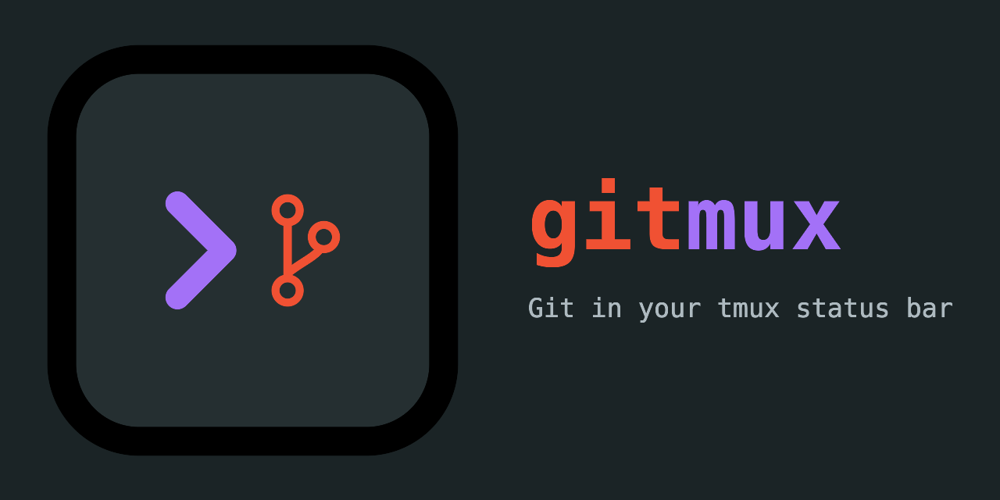
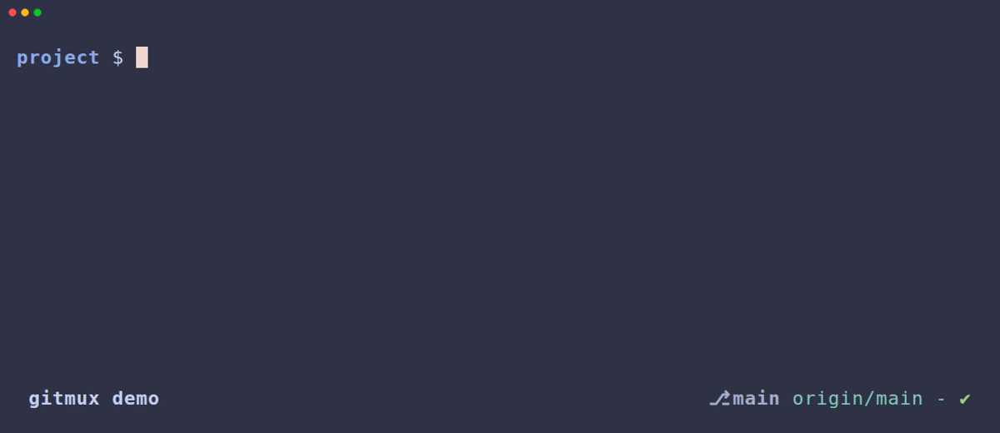

<p align="center">

</p>
<hr>
<p align="center">
<a href="https://github.com/arl/gitmux/actions/workflows/ci-cd.yaml">
  
</a>

<a href="https://goreportcard.com/report/github.com/arl/gitmux">
  
</a>
<a href="https://opensource.org/licenses/MIT">
  
</a>
</p>


# gitmux

Gitmux is a tmux addon to show git status in your status bar.





 - **easy**: install and forget
 - **minimal**: shows what you need, when you need it
 - **shell-agnostic**: works with your shell, since it does not rely on shell features
 - **customizable**: colors, symbols and layout are configurable

---

- [Prerequisites](#prerequisites)
- [Installing](#installing)
  - [Binary release](#binary-release)
  - [Homebrew (macOS and linux) (amd64 and arm64)](#homebrew-macos-and-linux-amd64-and-arm64)
  - [AUR](#aur)
  - [From source](#from-source)
- [Getting started](#getting-started)
  - [Command line interface](#command-line-interface)
- [Customizing](#customizing)
  - [Symbols](#symbols)
  - [Styles](#styles)
  - [Layout components](#layout-components)
  - [Additional options](#additional-options)
- [Troubleshooting](#troubleshooting)
  - [Gitmux takes too long to refresh?](#gitmux-takes-too-long-to-refresh)
- [Contributing](#contributing)
- [License: MIT](#license-mit)


## Prerequisites

Works with all reasonably recent [tmux](https://github.com/tmux/tmux) versions (2.1+)

## Installing

### Binary release

[Download the latest](https://github.com/arl/gitmux/releases/latest) binary for your platform/architecture and uncompress it.


### Homebrew (macOS and linux) (amd64 and arm64)

Install the latest version with:

    brew install gitmux

### AUR

Arch Linux users can download the [gitmux](https://aur.archlinux.org/packages/gitmux), [gitmux-bin](https://aur.archlinux.org/packages/gitmux-bin) or [gitmux-git](https://aur.archlinux.org/packages/gitmux-git) AUR package.

### From source

[Download and install a Go compiler](https://golang.org/dl/) (Go 1.16 or later).
Run `go install` to build and install `gitmux`:

    go install github.com/arl/gitmux@latest

## Getting started

If your `tmux` version supports `pane_current_path` (tmux v2.1+),
just add this line to your `.tmux.conf`:

    set -g status-right '#(gitmux "#{pane_current_path}")'

If your `tmux` doesn't support `pane_current_path` then you can use 
a [bash-specific solution](https://github.com/arl/gitmux/issues/19#issuecomment-594735939)
to achieve relatively similar behaviour: `gitmux` will refresh after every shell command 
you run or when you switch windows, however it won't refresh automatically, nor when switching panes.  

Note that `tmux v2.1` was released in 2015 so you're probably better off updating to a more recent version anyway 🙂.


### Command line interface

`gitmux` is not meant to be call directly but it still has a command line interface
that can be used to create the default configuration, troubleshoot your installation or during development:

```
$ gitmux -h
gitmux v0.11.5
Usage: gitmux [options] [dir]

gitmux prints the status of a Git working tree as a tmux format string.
If directory is not given, it default to the working directory.

Options:
  -cfg FILE       read gitmux config from FILE.
  -printcfg       prints default configuration file.
  -dbg            outputs Git status as JSON and print errors.
  -timeout DUR    exits if still running after given duration (ex: 2s, 500ms).
  -V              prints gitmux version and exits.
```


## Customizing

`gitmux` output can be customized via a configuration file in YAML format.

This is the default gitmux configuration file, in YAML format:

```yaml
tmux:
    symbols:
        branch: '⎇ '
        hashprefix: ':'
        ahead: ↑·
        behind: ↓·
        staged: '● '
        conflict: '✖ '
        modified: '✚ '
        untracked: '… '
        stashed: '⚑ '
        clean: ✔
        insertions: Σ
        deletions: Δ
    styles:
        clear: '#[fg=default]'
        state: '#[fg=red,bold]'
        branch: '#[fg=white,bold]'
        remote: '#[fg=cyan]'
        divergence: '#[fg=default]'
        staged: '#[fg=green,bold]'
        conflict: '#[fg=red,bold]'
        modified: '#[fg=red,bold]'
        untracked: '#[fg=magenta,bold]'
        stashed: '#[fg=cyan,bold]'
        clean: '#[fg=green,bold]'
        insertions: '#[fg=green]'
        deletions: '#[fg=red]'
    layout: [branch, " ", remote-branch, " ", divergence, " - ", flags]
    options:
        branch_max_len: 0
        branch_trim: right
        ellipsis: …
        hide_clean: false
        swap_divergence: false
        divergence_space: false
```

First, save the default configuration to a new file:

    gitmux -printcfg > $HOME/.gitmux.conf

Modify the line you've added to `.tmux.conf`, passing the path of the configuration file as argument to `gitmux` via the `-cfg` flag

    set -g status-right '#(gitmux -cfg $HOME/.gitmux.conf "#{pane_current_path}")'

Open `.gitmux.conf` and modify it, replacing symbols, styles and layout to suit your needs.

In `tmux` status bar, `gitmux` output immediately reflects the changes you make to the configuration.

`gitmux` configuration is split into 4 sections:
 - `symbols`: they're just strings of unicode characters
 - `styles`: tmux format strings
 - `layout`: list of `gitmux` layout components, defines the component to show and in their order.
 - `options`: additional configuration options


### Symbols

The `symbols` section defines the symbols printed before specific elements
of Git status displayed in `tmux` status string:

```yaml
  symbols:
        branch: "⎇ "    # current branch name.
        hashprefix: ":"  # Git SHA1 hash (in 'detached' state).
        ahead: ↑·        # 'ahead count' when local and remote branch diverged.
        behind: ↓·       # 'behind count' when local and remote branch diverged.
        staged: "● "     # count of files in the staging area.
        conflict: "✖ "   # count of files in conflicts.
        modified: "✚ "   # count of modified files.
        untracked: "… "  # count of untracked files.
        stashed: "⚑ "    # count of stash entries.
        insertions: Σ    # count of inserted lines (stats section).
        deletions: Δ     # count of deleted lines (stats section).
        clean: ✔         # Shown when the working tree is clean.
```


### Styles

Styles are tmux format strings used to specify text colors and attributes of Git
status elements.
See the [`STYLES` section](https://man7.org/linux/man-pages/man1/tmux.1.html#STYLES) of `tmux` man page.

```yaml
  styles:
    clear: '#[fg=default]'          # Clear previous style.
    state: '#[fg=red,bold]'         # Special tree state strings such as [rebase], [merge], etc.
    branch: '#[fg=white,bold]'      # Local branch name
    remote: '#[fg=cyan]'            # Remote branch name
    divergence: "#[fg=yellow]"      # 'divergence' counts
    staged: '#[fg=green,bold]'      # 'staged' count
    conflict: '#[fg=red,bold]'      # 'conflicts' count
    modified: '#[fg=red,bold]'      # 'modified' count
    untracked: '#[fg=magenta,bold]' # 'untracked' count
    stashed: '#[fg=cyan,bold]'      # 'stash' count
    insertions: '#[fg=green]'       # 'insertions' count
    deletions: '#[fg=red]'          # 'deletions' count
    clean: '#[fg=green,bold]'       # 'clean' symbol
```

### Layout components

The `layout` section defines what components `gitmux` shows and the order in which
they appear on `tmux` status bar.


For example, the default `gitmux` layout shows is:

```yaml
layout: [branch, " ", remote-branch, " ", divergence, " - ", flags]
```

It shows, in that order:
 - the local branch name,
 - the remote branch name
 - the local/remote divergence
 - a `-` character
 - and finally the flags representing the working tree state

Note that elements only appear when they make sense, for example if local and
remote branch are aligned, the divergence string won't show up. Same thing for
the remote branch, etc.

`gitmux` doesn't add any space between layout components, so you're free to put
them where you want (or nowhere). Since some components may not be shown,
consecutive spaces are compressed into a single one, so that you don't end up
with multiple spaces where a component is missing. If you really want multiple
spaces, use non-breaking spaces (`U+00A0`), these are left untouched.

But you can anyway choose to never show some components if you wish, or to present
them in a different order.

This is the list of the possible keywords for `layout`:

| Layout keywords  | Description                                        |       Example        |
| :--------------: | :------------------------------------------------- | :------------------: |
|     `branch`     | local branch name                                  |        `main`        |
| `remote-branch`  | remote branch name                                 |    `origin/main`     |
|   `divergence`   | divergence local/remote branch, if any             |       `↓·2↑·1`       |
|     `remote`     | alias for `remote-branch` followed by `divergence` | `origin/main ↓·2↑·1` |
|     `flags`      | Symbols representing the working tree state        |    `✚ 1 ⚑ 1 … 2`     |
|     `stats`      | Insertions/deletions (lines). Disabled by default  |      `Σ56 Δ21`       |
| any string `foo` | Non-keywords are shown as-is                       |    `hello gitmux`    |


Some example layouts:

 - default layout:

```yaml
layout: [branch, " ", remote-branch, " ", divergence, " - ", flags]
```

 - some examples layouts:

```yaml
layout: [branch, " ", divergence, " - ", flags]
```
```yaml
layout: [flags, " ", branch]
```
```yaml
layout: [branch, "|", flags, "|", stats]
```
```yaml
# local and remote branches separated by `...`, e.g. `main...origin/main`, and
# no `...` when there's no remote branch. To do so, the `remote` style is
# prefixed with `...`, so it only shows up when the remote branch does.
layout: [branch, remote-branch]
# in the 'styles' section
remote: '#[fg=cyan]...'
```


### Additional options

This is the list of additional configuration `options`:

| Option                | Description                                                                     |      Default       |
| :-------------------- | :------------------------------------------------------------------------------ | :----------------: |
| `branch_max_len`      | Maximum displayed length for local and remote branch names                      |   `0` (no limit)   |
| `branch_trim`         | Trim left, right or from the center of the branch (`right`, `left` or `center`) | `right` (trailing) |
| `ellipsis`            | Character to show branch name has been truncated                                |        `…`         |
| `hide_clean`          | Hides the clean flag entirely                                                   |      `false`       |
| `swap_divergence`     | Swaps order of behind & ahead upstream counts                                   |      `false`       |
| `divergence_space`    | Add a space between behind & ahead upstream counts                              |      `false`       |
| `flags_without_count` | Show flags symbols without counts*                                              |      `false`       |

*When `flags_without_count` is true, shows only symbols (empty symbols show nothing). When false (default), shows symbols with counts (empty symbols show counts only).

## Troubleshooting

Check the opened and closed issues and don't hesitate to report anything by [filing a new one](https://github.com/arl/gitmux/issues/new). 


### Gitmux takes too long to refresh?

In case gitmux takes too long to refresh, try to decrease the value of the `status-interval` option.
A reasonable value is 2 seconds, which you can set in `.tmux.conf` with:

    set -g status-interval 2

Check out [tmux man page](https://www.man7.org/linux/man-pages/man1/tmux.1.html#OPTIONS) for more details.


## Contributing

Pull requests are welcome.  
For major changes, please open an issue first to open a discussion.


## License: [MIT](./LICENSE)
